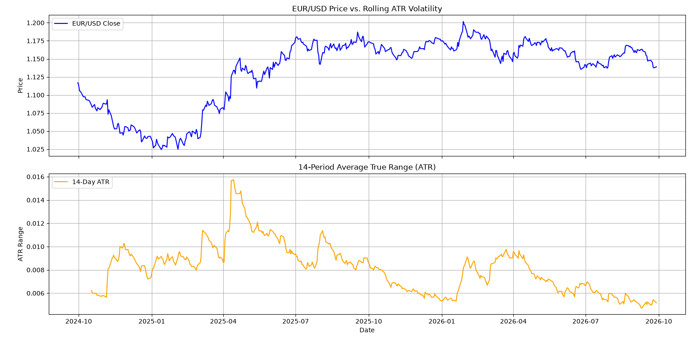

# FX Volatility & Rolling ATR Tracker 📈

A Python-based quantitative analytics tool designed to measure, track, and categorize foreign exchange (FX) price volatility using Welles Wilder's **Average True Range (ATR)**, **Percentile Ranks**, and **Volatility Ratio Analysis**.

---

## 🌟 Key Features

* **Data Ingestion & Cleaning:** Fetches live OHLC data from Yahoo Finance, standardizes timestamps, and handles FX-specific data quirks.
* **Wilder's ATR Engine:** Computes 14-period exponential Wilder's True Range (TR) and ATR.
* **Normalized Volatility:** Calculates ATR as a percentage of spot price ($\frac{\text{ATR}}{\text{Spot}} \times 100$) for direct cross-pair comparison.
* **Volatility Regime Categorization:** Ranks current volatility against a 252-trading-day lookback window:
  * **High Volatility:** $\ge 80\text{th}$ percentile
  * **Volatility Squeeze:** $\le 20\text{th}$ percentile
  * **Normal Volatility:** $20\text{th} - 80\text{th}$ percentile
* **Breakout / Expansion Ratio:** Computes $\frac{\text{ATR}_5}{\text{ATR}_{50}}$ to detect sudden volatility spikes.
* **Data Visualization:** Generates dual-panel price vs. volatility charts using Matplotlib.
## 📊 Output Preview


---
🔗 **Live Web Application:** [FX Volatility & Rolling ATR Tracker](https://fx-volatility-rolling-atr-tracker-nkuwgit7inh3cmifwlkqkm.streamlit.app/)
## 🛠️ Project Structure

```text
├── main.py              # Core script with data fetch, analytics, and plots
├── requirements.txt     # Python package dependencies
├── .gitignore          # File exclusion rules
└── README.md            # Project documentation
```

---

## 🚀 How to Run

1. **Clone the repository:**
   ```bash
   git clone [https://github.com/YOUR-USERNAME/fx-volatility-atr-tracker.git](https://github.com/YOUR-USERNAME/fx-volatility-atr-tracker.git)
   cd fx-volatility-atr-tracker
   ```

2. **Install dependencies:**
   ```bash
   pip install -r requirements.txt
   ```

3. **Run the script:**
   ```bash
   python main.py
   ```